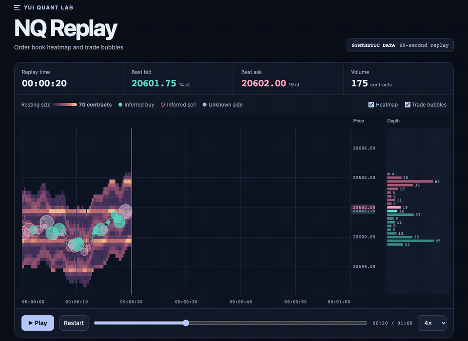
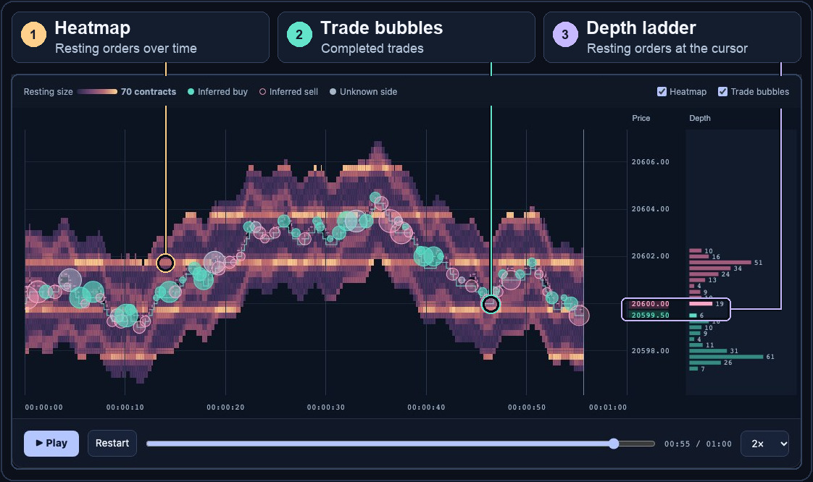

# NQ Order Flow Replay

An educational order flow replay for E-mini Nasdaq-100 (NQ) futures. Follow resting orders, trades, and current depth on a time-and-price heatmap. Start with synthetic recordings, then use a recording you are authorized to access.

## Preview

[**Play the interactive demo**](https://yuipan0611.github.io/nq-orderflow-replay/synthetic-replay.html) · [View the full-size screenshot](docs/replay-overview.jpg)



The 60-second demo uses synthetic market data. Use the player to play or pause, drag the timeline to seek, change playback speed, toggle chart layers, or hover over trades and price levels.

<details>
<summary>Trade tooltip and depth ladder</summary>


</details>

## Quick start

Clone the repository and run the following command from its root with Python 3.10 or later. The standard library handles the download and replay.

```sh
python replay.py --sample synthetic-open --write
```

Open the generated `index.html` in a browser. It runs offline. On the first run, the command downloads the selected gzip file from [Synthetic replay samples v1](https://github.com/yuipan0611/nq-orderflow-replay/releases/tag/samples-v1) and checks its SHA-256. Subsequent runs reuse the verified file in `~/.cache/nq-orderflow-replay/samples-v1/`.

| Sample | What to look for |
| --- | --- |
| `synthetic-open` | Fast price changes and frequent trades |
| `synthetic-imbalance` | A bright bid-side liquidity band and more buy-initiated trades |
| `synthetic-quiet` | A narrow price range and sparse trades |

Each sample has a three-minute default window. Override the start and end to study a shorter segment.

```sh
python replay.py --sample synthetic-imbalance --start 10:00:30 --end 10:01:15 --write
```

## Replay your own recording

Pass a local `.csv` or `.csv.gz` in the [event format below](#input-format).

```sh
python replay.py --source "/path/to/recording.csv.gz" --date 2026-01-06 --start 09:30:00 --end 09:32:00 --write
```

- Use the date and clock written in your recording. The player shows source time as recorded.
- The start is inclusive and the end is exclusive. Select up to five minutes within one calendar date. The file must contain an event at or before the start and an event at or after the end on that date.
- Keep the day's opening book or earlier events for warm-up. Include the end boundary event even when preparing a smaller extract.
- Omit `--write` to print replay statistics without generating HTML.

The original command using `--source` on its own still selects **2026-01-05 05:00:02–05:01:02**. With no source or sample specified, it looks for `Desktop/NQ_L2/NQ_L2_2026-01/01/20260105.csv` under your home directory. The time zone of that recording is unverified.

## Replay a Databento DBN file

For a local CME Globex `GLBX.MDP3` `mbp-10` file, install the optional reader once.

```sh
python -m pip install "databento-dbn>=0.70"
```

From the repository root, run one command to select an NQ contract and generate the standalone player.

```sh
python replay.py --dbn "/path/to/recording.mbp-10.dbn.zst" --symbol NQH6 --date 2026-01-06 --start 14:30:00 --end 14:32:00 --write
```

Open the generated `index.html` in a browser. The importer reads the existing file locally, resolves the single-contract raw symbol from the embedded DBN metadata, and converts the selected book and trade events in memory. It needs no Databento API key. [Databento DBN format and decoder](https://github.com/databento/dbn)

- Use UTC capture times (`ts_recv`). Select a window of up to five minutes within one UTC date. The selected contract needs a record at or before the start and a record at or after the end. The importer uses the last earlier book to initialize the clip. [Databento timestamp fields](https://databento.com/docs/conventions/common-fields-enums-types#ts-recv)
- Use the outright symbol present in the file, such as `NQH6`. Spread and continuous aliases are outside this importer’s contract selection. The chart uses the replay’s existing nine-tick depth range and infers trade direction from the preceding best quotes.
- The generated HTML embeds the selected market data. Keep the source file and generated player local under your data provider’s terms. The repository ignores DBN files and the generated root `index.html`.

## Where to get historical Level 2 data

For this project, start with CME futures **market depth** for a specific NQ contract month. Look for Level 2 or market-by-price depth and timestamped trades so you can reconstruct both chart layers. Verify the dates and contract coverage with the provider before purchasing.

| Source | How to get depth | Import into this replay |
| --- | --- | --- |
| **Databento** | Request CME Globex data (`GLBX.MDP3`) using the Historical API or batch download. Choose `mbp-10` for aggregated top-ten depth and trades. | Load an `mbp-10` DBN file directly with [`--dbn`](#replay-a-databento-dbn-file). [Historical API quickstart](https://databento.com/docs/quickstart/historical) · [MBP-10 schema](https://databento.com/docs/schemas/mbp-10) |
| **NinjaTrader Market Replay** | In NinjaTrader, use **Tools → Historical Data → Get Market Replay data** and check availability for your contract and date. Market Replay includes Level I and Level II. The separate Historical Tick mode provides tick data. | Replay files are for NinjaTrader Playback. Import here requires converting the Level I and Level II events to the event CSV. [Playback setup](https://ninjatrader.com/support/helpguides/nt8/set_up12.htm) · [Playback data types](https://static.ninjatrader.com/support/helpGuides/nt8/playback.htm) |
| **Sierra Chart / Denali** | Enable historical market depth downloads for the CME contract in Sierra Chart. The platform stores depth in daily `.depth` files. | Decode the depth records and combine them with timestamped quotes and trades before converting to the event CSV. [Historical depth setup](https://www.sierrachart.com/index.php?ID=375&page=doc/StudiesReference.php) · [Depth file format](https://www.sierrachart.com/index.php?page=doc/MarketDepthDataFileFormat.html) |

The public samples are generated from scratch. Check your provider and exchange terms before publishing licensed market data, including CSV exports or generated HTML that embeds the recording. [CME historical distribution guidelines](https://www.cmegroup.com/market-data/distributor/files/cme-group-data-licensing-policy-guidelines-historical-information-distribution.pdf)

## Read the chart

The **order book** lists visible buy and sell orders waiting at each price. These are called **resting orders**. When a buy and a sell match, the resulting execution appears as a **trade**. The player brings these two views together.



*The numbered examples below refer to this screenshot from the synthetic demo.*

### 1. Heatmap · Where were orders waiting?

Read **time** from left to right and **price** from bottom to top. Each colored cell shows how many resting contracts were visible at that price in a 100 ms sample. Brighter cells mean more contracts. A bright horizontal band means orders kept appearing at the same price across successive samples. The chart reveals that history up to the replay cursor.

In the example, the highlighted band shows **44 resting contracts at 20,601.75** around **00:00:14**. A band can brighten as orders arrive or fade as orders are filled, canceled, or leave the displayed range. Use trade bubbles to check where executions occurred.

### 2. Trade bubbles · What actually traded?

Each bubble marks an execution at a specific **time and price**. A larger circle represents more traded contracts. The quantity is encoded by the circle's area. On the historical replay, teal means the trade matched the preceding best ask and is inferred to be buy-initiated. Pink means it matched the preceding best bid and is inferred to be sell-initiated. Gray means the initiating side is unknown.

Hover over the highlighted bubble in the synthetic demo to see **11 contracts at 20,600.00** at **00:00:46.425**, labeled **Inferred sell**.

### 3. Depth ladder · What is still waiting right now?

The bars on the right show a **single snapshot** at the replay cursor. Each row is a price. Teal bars show buy orders (*bids*) and pink bars show sell orders (*asks*). A longer bar means more visible contracts waiting at that price. Drag the timeline to see the ladder update to the selected moment.

At about **00:00:55**, the highlighted rows show **6 contracts at the best bid of 20,599.50** and **19 contracts at the best ask of 20,600.00**.

The player opens paused up to 20 seconds into the clip so the chart is visible immediately. Use **Play** or **Pause** to control playback and **Restart** to return to the start. Drag the timeline to seek, choose a speed from 0.5× to 4×, or toggle either chart layer. Hover over the chart for a price-level or trade tooltip.

## Input format

The generator reads plain or gzip-compressed, headerless, semicolon-delimited event files. Timestamps use `YYYYMMDDHHMMSSffffff`, with six fractional-second digits. Prices must align with NQ's 0.25-point tick. The generator reads the opening events before the clip to initialize the book and preserves file order when timestamps tie.

| Stream | Row layout | Event codes used in the demo |
| --- | --- | --- |
| Level 1 | `timestamp;1;event_code;price;size` | `0` bid quote, `1` ask quote, `2` trade. Other Level 1 codes are counted as market statistics. |
| Level 2 | `timestamp;2;side_code;price;size;rank;action` | Side `0` bid or `1` ask. Action `0` add, `1` update, or `2` remove. The parser accepts ranks 1–10. |

Keep rows in chronological order. For files containing multiple dates, the generator initializes the book from events on the selected date.

## Replay and validation

- **Top of book.** Best bid, best ask, and their quoted sizes come from Level 1.
- **Outer depth.** Level 2 updates are applied by side and price. The heatmap samples every 100 ms and displays observed outer levels up to nine ticks from the current best quote on each side. A level that leaves that range must be observed again before it can reappear.
- **Trade direction.** A trade at the preceding best ask is inferred as buy-initiated. A trade at the preceding best bid is inferred as sell-initiated. The rest are marked unknown.

The original clip contains **3,217 events**, including **1,874 depth updates**, and **94 trades totaling 103 contracts**. All 600 sampled quote frames and 9,962 displayed outer-depth values were checked against the source events. Trade prices, timestamps, and sizes were also reconciled. Direction remained unknown for 22 trades. This validation covers the one-minute window and the depth displayed in the demo.

## Project files

- [`replay.py`](replay.py) parses the recording, builds the replay, prints validation statistics, and writes the standalone page.
- [`databento_input.py`](databento_input.py) reads local CME MBP-10 files and converts book snapshots and trades into replay events.
- [`replay-template.html`](replay-template.html) contains the Canvas chart and player controls.
- [`scripts/build_samples.py`](scripts/build_samples.py) generates the synthetic CSVs. [`samples.json`](samples.json) records their release version, windows, and checksums.
- `index.html` is generated locally and ignored by Git because it embeds the replay data.
