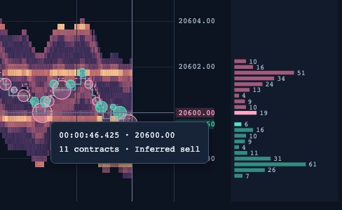

# NQ Order Flow Replay

An offline order flow viewer for E-mini Nasdaq-100 (NQ) futures. Replay a one-minute recording as a time-and-price heatmap with trade bubbles and a depth ladder at the current replay position.

## Preview


[View the full-size screenshot](docs/replay-overview.jpg) · [Open the interactive demo file](docs/synthetic-replay.html)

The preview uses synthetic market data. To try the full 60-second replay offline, open the demo file, choose **Download raw file**, then open the saved HTML in your browser. You can play or pause, seek, change playback speed, toggle chart layers, and hover over trades or price levels.

<details>
<summary>Trade tooltip and depth ladder</summary>



</details>

## Quick start

The historical replay uses the January 5, 2026 recording from `05:00:02` up to `05:01:02`. The player displays timestamps as recorded. The source time zone is unverified.

You need Python 3.10 or later, a modern browser, and your own copy of the `20260105.csv` recording. The generator uses the Python standard library, so there are no packages to install. Market data is kept outside the repository.

```powershell
git clone https://github.com/yuipan0611/nq-orderflow-replay.git
cd nq-orderflow-replay
python replay.py --source "C:\path\to\20260105.csv" --write
```

Replace the example path with the location of your CSV. If you omit `--source`, the generator looks for `Desktop/NQ_L2/NQ_L2_2026-01/01/20260105.csv` under your home directory.

Open the generated `index.html` in your browser. It contains everything needed for offline playback. To print replay statistics without writing HTML, run the same command without `--write`.

## Read the chart

The **order book** lists visible buy and sell orders waiting at each price. These are called **resting orders**. When a buy and a sell match, the resulting execution appears as a **trade**. The player brings these two views together.


*The numbered examples below refer to this screenshot from the synthetic demo.*

### 1. Heatmap · Where were orders waiting?

Read **time** from left to right and **price** from bottom to top. Each colored cell shows how many resting contracts were visible at that price in a 100 ms sample. Brighter cells mean more contracts. A bright horizontal band means orders kept appearing at the same price across successive samples. The chart reveals that history up to the replay cursor.

In the example, the highlighted band shows **44 resting contracts at 20,601.75** around **00:00:14**. A band can brighten as orders arrive or fade as orders are filled, canceled, or leave the displayed range. Use trade bubbles to check where executions occurred.

### 2. Trade bubbles · What actually traded?

Each bubble marks an execution at a specific **time and price**. A larger circle represents more traded contracts. The quantity is encoded by the circle's area. On the historical replay, teal means the trade matched the preceding best ask and is inferred to be buy-initiated. Pink means it matched the preceding best bid and is inferred to be sell-initiated. Gray means the initiating side is unknown.

Hover over the highlighted bubble in the synthetic demo to see **11 contracts at 20,600.00** at **00:00:46.425**, labeled **Inferred sell**.

### 3. Depth ladder · What is still waiting right now?

The bars on the right show a **single snapshot** at the replay cursor. Each row is a price. Teal bars show buy orders (*bids*) and pink bars show sell orders (*asks*). A longer bar means more visible contracts waiting at that price. Drag the timeline to see the ladder update to the selected moment.

At about **00:00:55**, the highlighted rows show **6 contracts at the best bid of 20,599.50** and **19 contracts at the best ask of 20,600.00**.

The player opens paused 20 seconds into the clip so the chart is visible immediately. Use **Play** or **Pause** to control playback and **Restart** to return to the start. Drag the timeline to seek, choose a speed from 0.5× to 4×, or toggle either chart layer. Hover over the chart for a price-level or trade tooltip.

## Input format

The demo expects a headerless, semicolon-delimited event recording. Timestamps use `YYYYMMDDHHMMSSffffff`, with six fractional-second digits. Prices must align with NQ's 0.25-point tick. The generator reads the opening events before the clip to initialize the book and preserves file order when timestamps tie.

| Stream | Row layout | Event codes used in the demo |
| --- | --- | --- |
| Level 1 | `timestamp;1;event_code;price;size` | `0` bid quote, `1` ask quote, `2` trade. Other Level 1 codes are counted as market statistics. |
| Level 2 | `timestamp;2;side_code;price;size;rank;action` | Side `0` bid or `1` ask. Action `0` add, `1` update, or `2` remove. The parser accepts ranks 1–10. |

The input path is configurable. The date, time window, and column layout are fixed for this demo.

## Replay and validation

- **Top of book.** Best bid, best ask, and their quoted sizes come from Level 1.
- **Outer depth.** Level 2 updates are applied by side and price. The heatmap samples every 100 ms and displays observed outer levels up to nine ticks from the current best quote on each side. A level that leaves that range must be observed again before it can reappear.
- **Trade direction.** A trade at the preceding best ask is inferred as buy-initiated. A trade at the preceding best bid is inferred as sell-initiated. The rest are marked unknown.

The original clip contains **3,217 events**, including **1,874 depth updates**, and **94 trades totaling 103 contracts**. All 600 sampled quote frames and 9,962 displayed outer-depth values were checked against the source events. Trade prices, timestamps, and sizes were also reconciled. Direction remained unknown for 22 trades. This validation covers the one-minute window and the depth displayed in the demo.

## Project files

- [`replay.py`](replay.py) parses the recording, builds the replay, prints validation statistics, and writes the standalone page.
- [`replay-template.html`](replay-template.html) contains the Canvas chart and player controls.
- `index.html` is generated locally and ignored by Git because it embeds the replay data.
